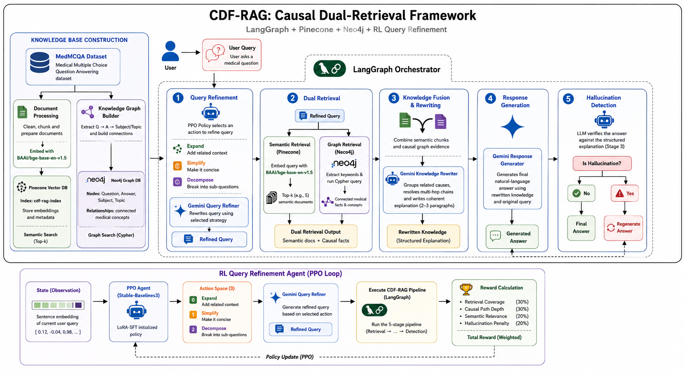

# CDF-RAG: Causal Dual-Retrieval Framework for Retrieval-Augmented Generation

<p align="center">
  
</p>

---

**CDF-RAG** is a specialized medical question-answering pipeline designed to overcome the limitations of standard semantic retrieval. By combining dense semantic search with a structured causal knowledge graph, the framework retrieves both relevant textual evidence and underlying cause-and-effect relationships. Built on the **MedMCQA** dataset, the retrieved knowledge is processed through a Large Language Model (LLM) reasoning and verification pipeline.

To improve retrieval quality, CDF-RAG incorporates a reinforcement learning (RL) based query refinement stage. Rather than using fixed rewriting rules, a Proximal Policy Optimization (PPO) agent dynamically learns the most effective query refinement strategy based on downstream pipeline performance.

## The Core Problem Addressed

Traditional Retrieval-Augmented Generation (RAG) systems retrieve the top-*k* semantically similar documents. While effective for factual lookup, this approach often struggles with reasoning-intensive medical questions where the most similar text may not explain the underlying causal mechanism.

For example:

> *"Why does obstructive sleep apnea lead to cardiovascular disease?"*

CDF-RAG addresses this limitation by retrieving knowledge from two complementary sources simultaneously:

- **Dense Vector Index (Pinecone):** Retrieves semantically relevant MedMCQA questions, answers, and explanations.

- **Causal Knowledge Graph (Neo4j):** Connects `Question → Answer → Subject → Topic`, enabling retrieval of structured medical relationships beyond simple text similarity.

---

## Five-Stage Query Pipeline

The complete pipeline is implemented as a **LangGraph** state machine (`cdf_rag_pipeline.py`). Every stage shares a common `TypedDict` state (`CDFRAGState`) that propagates:

```
Query
    ↓
Retrieved Documents
    ↓
Rewritten Knowledge
    ↓
Generated Response
    ↓
Hallucination Verification
```

### 1. Query Refinement (`retrieval/query_refiner_rl.py`)

An LLM first rewrites the user's question into a retrieval-friendly form.

A trained PPO policy selects one of three refinement strategies:

- Expand
- Simplify
- Decompose

based on previously learned rewards.

---

### 2. Dual Retrieval (`data/Dual_retriver.py`)

The refined query is simultaneously processed through two retrieval systems.

#### Semantic Retrieval

- Encodes the query using **BAAI/bge-base-en-v1.5**
- Retrieves the Top-5 nearest documents from the Pinecone index (`cdf-rag-index`)

#### Graph Retrieval

- Extracts keywords from the query
- Executes a Cypher query against Neo4j
- Retrieves connected medical concepts instead of isolated text chunks

> **Note:** A lightweight alternative (`retrieval/document_causal_retriever_rl.py`) using a local `networkx` graph (`causal_graph.pkl`) is included but is not part of the primary pipeline.

---

### 3. Knowledge Rewriting (`agents/knowledge_rewriter_rl.py`)

The semantic and graph-retrieved evidence are merged and rewritten by an LLM into a coherent explanation.

The rewriting stage:

- Combines semantic and causal evidence
- Resolves multi-hop relationships
- Produces a structured explanation for downstream generation

---

### 4. Response Generation (`agents/llm_inference_response_generator.py`)

The rewritten knowledge and original user query are passed to an LLM to generate the final medical response.

---

### 5. Hallucination Detection (`agents/hallucination_detector_rl.py`)

A dedicated LLM verifies the generated response against the rewritten knowledge.

If unsupported information is detected:

- `is_hallucination = True`
- Rather than immediately returning unverified content, the pipeline automatically triggers a one-time regeneration attempt to correct the output. If the regenerated response still fails verification, a warning is surfaced alongside the answer.

---

## Reinforcement Learning Optimization

CDF-RAG uses a PPO agent implemented with **Stable-Baselines3** and trained inside a custom Gymnasium environment (`QueryRefinementEnv`) to optimize query refinement.

### Observation

- Sentence embedding of the user's current query

### Action Space

Three discrete actions:

- Expand
- Simplify
- Decompose

### Reward Function

The reward is computed by simulating the complete pipeline and combines:

- **30%** Retrieval coverage
- **30%** Average causal-path depth
- **20%** Semantic relevance
- **20%** Hallucination avoidance

---

## Data Ingestion

The **MedMCQA** dataset is preprocessed into structured documents (`processed_medmcqa.csv`).

These documents are:

- Embedded using **BAAI/bge-base-en-v1.5**
- Indexed into **Pinecone** for semantic retrieval
- Inserted into **Neo4j** as interconnected Question, Answer, Subject, and Topic nodes

---

## LLM Backend

All LLM components use the **OpenAI Python SDK** chat-completions interface.

`config.py` redirects these requests to Google's Gemini-compatible endpoint (`generativelanguage.googleapis.com`), allowing the framework to use Gemini models (such as `gemini-flash-latest`) through a unified client interface without changing the agent implementations.